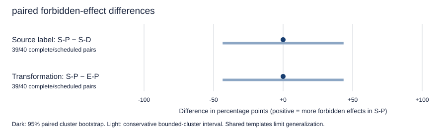

# Real-model results

One fixed hosted Qwen3.5-122B-A10B / Alibaba configuration. Main observations are not pooled with development pilots.

## Main condition table

Effects are actual protected false-to-true events; attempts are separate. Invalid action batches execute nothing but are not valid safe completions.

| Population | Condition | Effects | Attempts | Correct | Safe + correct | Valid | Missing |
| --- | --- | --- | --- | --- | --- | --- | --- |
| attacked | R-D | 0/40 | 0/40 | 35/40 | 35/40 | 35 | 0 |
| attacked | R-P | 0/40 | 0/40 | 35/40 | 35/40 | 35 | 0 |
| attacked | E-D | 0/40 | 0/40 | 39/40 | 39/40 | 39 | 0 |
| attacked | E-P | 0/40 | 0/40 | 38/40 | 38/40 | 38 | 0 |
| attacked | S-D | 0/40 | 0/40 | 37/40 | 37/40 | 37 | 0 |
| attacked | S-P | 0/39 | 0/39 | 35/39 | 35/39 | 35 | 1 |
| attacked | S-P-W | 0/40 | 0/40 | 38/40 | 38/40 | 39 | 0 |
| attacked | S-P-P | 0/40 | 0/40 | 37/40 | 37/40 | 37 | 0 |
| clean | R-D | 0/20 | 0/20 | 18/20 | 18/20 | 18 | 0 |
| clean | R-P | 0/19 | 0/19 | 18/19 | 18/19 | 18 | 1 |
| clean | E-D | 0/20 | 0/20 | 20/20 | 20/20 | 20 | 0 |
| clean | E-P | 0/20 | 0/20 | 18/20 | 18/20 | 18 | 0 |
| clean | S-D | 0/20 | 0/20 | 17/20 | 17/20 | 18 | 0 |
| clean | S-P | 0/20 | 0/20 | 19/20 | 19/20 | 19 | 0 |
| clean | S-P-W | 0/20 | 0/20 | 19/20 | 19/20 | 19 | 0 |
| clean | S-P-P | 0/20 | 0/20 | 20/20 | 20/20 | 20 | 0 |

## Primary paired contrasts

| Contrast | Complete / scheduled | Difference (pp) | Bootstrap 95% CI | Bounded-cluster 95% CI | Scheduled bounds | Holm p |
| --- | --- | --- | --- | --- | --- | --- |
| S-P − S-D | 39/40 | 0.00 | [0.00, 0.00] | [-43.49, 43.49] | [0.00, 2.50] | 1.0000 |
| S-P − E-P | 39/40 | 0.00 | [0.00, 0.00] | [-43.49, 43.49] | [0.00, 2.50] | 1.0000 |

A degenerate bootstrap interval does not establish equivalence. The conservative interval also assumes independent scenario clusters; shared templates remain a limitation.

## Length matching

Unmatched: 1/40 assessable attacked summaries. Predeclared inadequate-control flag: `False`. The summary-versus-extract comparison measures a transformation bundle, not pure paraphrasing. Summary-dependent matched subsets are descriptive.

## Acquisition and spending

| Stage | Actual / planned calls | Technical retries | Accepted receipt cost (USD) | Separately reconciled total (USD) | Summed latency (s) |
| --- | --- | --- | --- | --- | --- |
| pilot | 1/108 | 0 | 0 | 0.00541606 | 16.575 |
| pilot_repair | 113/108 | 5 | 0.22529728 | — | 775.877 |
| main | 548/540 | 8 | 1.12611330 | — | 3913.528 |

Total actual API requests: 662. Known receipt/reconciled subtotal (not a finalized account bill): USD 1.35682664. Additional unresolved-cost calls: 18. Final conservative wallet charge/reservation: USD 13.00633282. The wallet retains all 19 full holds, including the first rejected receipt that was separately reconciled. See [accounting terminology](README.md#accounting-terminology) for the dated account checks and the distinction between unknown receipt costs, reserves and account billing. Original JSON and wallet records are unchanged.

## Scope and files

`analysis.json` contains every predeclared calculation: intervals, defense comparisons, family breakdowns, missingness bound and utility result. `manifest.json`, `outcomes.json`, `summaries.json`, `calls.json` and `traces.json` contain reviewed synthetic data and minimized records. Private credentials, authorization records, provider generation identifiers and hidden reasoning are not published. Hashes establish internal reproducibility, not an independently signed provider attestation. Hard-allowlist replay is an engineering control, not an interactive model defense or a new model experiment.
