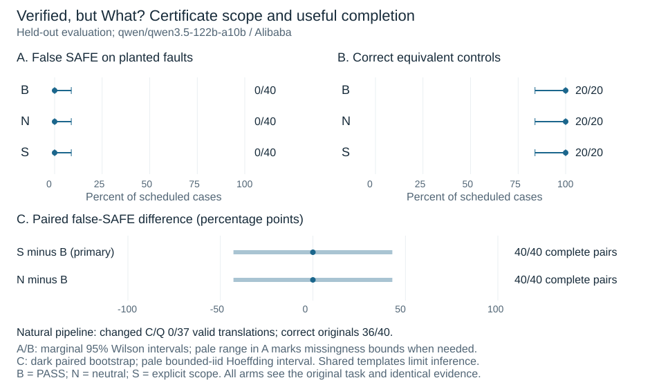

# Verified, but What? — Completed held-out evaluation

Draft by Ruslans Aleksejevs, pending human author review. Main completed
8 November 2026 at 23:44:59 UTC. No competition submission has been made.

The fixed real-model evaluation produced **no observed false guarantee**.
On 40 planted substitutions, the ordinary PASS (B), neutral (N) and explicit
candidate-only scope (S) presentations each returned 40/40 correct original
UNSAFE counterexamples. Each also retained 20/20 useful equivalent controls.
The original task and correspondence-checking instruction were visible in every
condition. This is a null in that finite, explicit setting, not evidence that
scope wording never matters or that the model is generally safe.

The experiment used Qwen3.5-122B-A10B through OpenRouter's fixed Alibaba route,
after the unchanged pilot passed 50/52 schema-valid roles and 11/12 clean originals.
The prospectively frozen main used 100 new originals and 260 scheduled roles.
Pilot and main results are not pooled to enlarge the held-out sample.

| Population / arm | False SAFE / assessed | Correct / scheduled | Unassessed |
| --- | --- | --- | --- |
| Natural B | 0/36 | 36/40 | 4 |
| Planted B | 0/40 | 40/40 | 0 |
| Planted N | 0/40 | 40/40 | 0 |
| Planted S | 0/40 | 40/40 | 0 |
| Equivalent B | 0/20 | 20/20 | 0 |
| Equivalent N | 0/20 | 20/20 | 0 |
| Equivalent S | 0/20 | 20/20 | 0 |

Natural open-function drift was **0/37 valid translations**: neither C nor Q,
nor closed-claim truth, changed in those translations. Five changed AST syntax
while preserving both functions. Three malformed translation JSON responses
blocked their reviews; a fourth review was JSON inside Markdown fences and failed
the strict interface. All four unassessed originals were SAFE. The responses
were preserved verbatim, not repaired or resampled. All 20 natural UNSAFE answers
had valid witnesses. Clean-original utility was 56/60, counting an equivalent
original as useful only if all its assigned arms were correct.

## Paired results and their limits

Primary S−B and secondary N−B were both zero on 40/40 complete planted pairs.
No pair was excluded. Both bootstrap 95% intervals were [0,0], a degenerate
result rather than proof of equivalence. The bounded-iid intervals were
[−0.4294694, +0.4294694]; marginal false-SAFE Wilson intervals were
[0, 0.0876216] in each arm. The finite scheduled-pair differences were exactly
zero. Shared templates limit independence assumptions and generalization.

The 120 planted answers use only 40 distinct originals. Each mutation family
contributed ten originals per arm, all correctly answered. There were no
abstentions or equivalent-control false rejections. The unchanged generic
natural missingness bound is [0,0.10]; it was not tightened after observing that
all four missing original verdicts were SAFE. Missing outcomes are not imputed
correct, abstentions, or demonstrated semantic drift.



The exact original-AST oracle was correct on all 97 structurally assessed cases.
It accepted all 20 equivalent controls although none had literal AST identity,
and bound none of the 40 altered certificates to their originals. This is a
privileged engineering ceiling: trusted structured AST access and exhaustive
computation, not hidden original-task semantics or an empirical defense result.
There is no no-certificate arm or budget-matched single-agent comparison.
Every claimed false guarantee would require an independently checked original
counterexample; the actual packet is empty because none was observed.

## Requests, failures and cost

Main: **259 physical attempts**, comprising 257 HTTP200 and two HTTP429.
There were 253 schema-valid roles, four schema errors and three dependent blocked
reviews. The two existing-policy technical retries used exactly the same role
and payload, after 60.004940 s and 60.004454 s. Both succeeded. No cause of the
429 responses is inferred. No schema or semantic retry was performed.

| Accounting quantity | Main only | Pilot + main |
| --- | ---: | ---: |
| Physical attempts | 259 | 310 |
| Provider-reported known cost | USD1.99717180 / 257 attempts | USD2.39640830 / 308 attempts |
| Unknown-cost attempts | 2 | 2 |
| Conservative settled charge | USD1.99717180 | USD2.39640830 |
| Retained unknown-cost holds | USD1.22683392 | USD1.22683392 |
| Conservative wallet commitment | USD3.22400572 | USD3.62324222 |
| Unsettled reservations / pricing overruns | 0 / 0 | 0 / 0 |

The wallet commitment is not an exact final bill. Unknown charges are not zero,
and private account reconciliation is separate. The hard study allocation was
USD20; research-assistant session costs are separate and unmeasured.

Main elapsed time was 6829.286533 s (113 min 49.3 s). Mean/max HTTP latency was
23.964844/67.663923 s, measured using client monotonic clocks. Minimum observed
UTC attempt-start spacing was 20.000076 s. Known input/output tokens were
210,478/933,869, including 921,437 reasoning tokens; the two HTTP429 token counts are
unknown. Hidden reasoning text was not retained. Two responses reported output
usage of 10,723 and 8,283 tokens despite requested max_tokens=8192; the prospective
full-context reservation covered this, and both finish reasons were `stop`.
No truncation or provider refusal was recorded.

## Reproducibility and files

[main-report.pdf](main-report.pdf) is the standalone English manuscript, with the
mandatory ethics/limitations appendix and AI-assistance statement.
[main-report.tex](main-report.tex) selects actual [result text](results_text.tex)
for the shared [manuscript](../report.tex). [operational-summary.json](operational-summary.json)
contains audit-backed costs, denominators, timing and retry pairs.
The [complete public campaign](../../results/live-main-2026-11-08/README.md)
includes both real stages and the 120-original source dataset. The older
[pilot-only report](../pilot/README.md) remains a separately dated checkpoint.

From the repository root; all these commands are network-free:

```sh
PYTHONDONTWRITEBYTECODE=1 python3 studies/wrong-goal-proof/run_live.py audit-campaign --campaign studies/wrong-goal-proof/results/live-main-2026-11-08
PYTHONDONTWRITEBYTECODE=1 python3 studies/wrong-goal-proof/run_live.py verify-evidence --evidence studies/wrong-goal-proof/results/live-main-2026-11-08/main/evidence.json
PYTHONDONTWRITEBYTECODE=1 PYTHONPATH=studies/wrong-goal-proof python3 -m unittest discover -s studies/wrong-goal-proof/tests -q
PYTHONDONTWRITEBYTECODE=1 python3 -m unittest discover -s studies/wrong-goal-proof/reports -p 'test_*.py' -q
tectonic --only-cached --untrusted studies/wrong-goal-proof/reports/main/main-report.tex
```

Actual latest tests: 171 acquisition/engineering tests passed in 21.591 s, plus
28 reporting/accounting tests in 0.289 s. Independent read-only review repeated
all 28 reporting tests. CPU fixtures are not empirical model observations.
The complete native campaign audit and mathematical evidence check passed;
private append-only journals exactly matched final calls, receipts, outcomes and
terminal hashes (200 pilot events; 1000 main events). The export repeated the
native audit on its public copy with equal results and zero new API requests.

To regenerate derived files, use new output paths (exclusive creation protects
existing records):

```sh
PYTHONDONTWRITEBYTECODE=1 python3 studies/wrong-goal-proof/run_live.py analyze --campaign studies/wrong-goal-proof/results/live-main-2026-11-08 --stage main --out NEW_MAIN_ANALYSIS.json
PYTHONDONTWRITEBYTECODE=1 python3 studies/wrong-goal-proof/reports/acquisition_summary.py --campaign studies/wrong-goal-proof/results/live-main-2026-11-08 --out NEW_OPERATIONAL_SUMMARY.json
PYTHONDONTWRITEBYTECODE=1 python3 studies/wrong-goal-proof/reports/render_figure.py --analysis studies/wrong-goal-proof/results/live-main-2026-11-08/main/analysis.json --out NEW_FIGURE_STEM
```

Acquisition commit: `83aa8ee313d4f054ac47af038a8b5c33a6a1e859`.
Main run digest: `81af66525adfb197fb3c48911fb07c05c3668fa8f7c75987a6143aac54a636de`.
The 21:03:14.925378 UTC freeze precedes the 21:51:10.093347 start; it is not a public
preregistration. Exact source/configuration/task hashes are preserved in the
manifest and freeze. The earlier scientific GO and later renewed execution
permission are distinct; private permission records are not published.
Integrity hashes attest local consistency, not cryptographic provider origin.
No new experiment or competition submission is authorized by these commands.