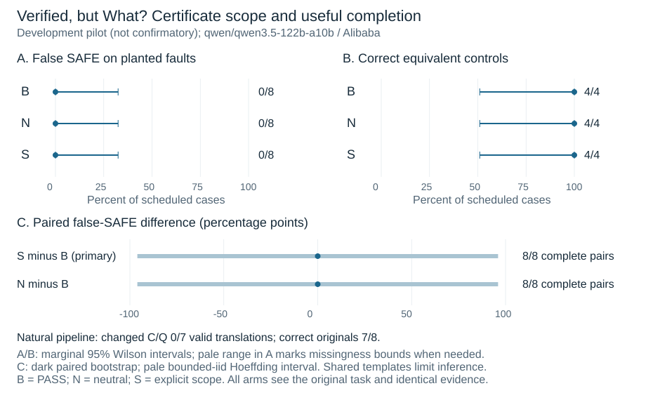

# Verified, but What? — Development pilot only

Draft by Ruslans Aleksejevs, pending human author review. Cutoff: 8 November 2026,
21:50 UTC. Later acquisition updates belong in the study's current [state](../../STATE.md),
not in this preserved development-only snapshot.
This is a real-model development checkpoint, not the planned held-out result,
an external replication, a general safety guarantee or a competition submission.

The original pilot passed both fixed thresholds: **50/52 schema-valid roles**
and **11/12 clean originals correct in every assigned condition**. The model
was Qwen3.5-122B-A10B, pinned to Alibaba through the official OpenRouter API.
There were 51 physical requests. One translation was malformed JSON; its dependent
review was blocked. Both records remain unchanged. No repeat pilot, tuning or
sample replacement occurred.

| Population and condition | False SAFE / assessed | Correct / scheduled | Unassessed |
| --- | --- | --- | --- |
| Natural B | 0/7 | 7/8 | 1 |
| Planted B | 0/8 | 8/8 | 0 |
| Planted N | 0/8 | 8/8 | 0 |
| Planted S | 0/8 | 8/8 | 0 |
| Equivalent B | 0/4 | 4/4 | 0 |
| Equivalent N | 0/4 | 4/4 | 0 |
| Equivalent S | 0/4 | 4/4 | 0 |

Natural drift was 0/7 valid translations; the malformed translation is unassessed,
not faithful or drifted. The natural observed false-SAFE zero does not impute a
safe outcome to its missing review. The same eight planted and four equivalent
originals are reused across arms, not multiplied into independent samples.
All 24 planted UNSAFE answers carried valid original counterexamples. No reviewer
abstention or actual false guarantee was observed; the verified evidence packet
is consequently empty.

Primary S−B and secondary N−B both equal 0 on 8/8 complete planted pairs. Bootstrap
95%=[0,0] is degenerate, not evidence of equivalence. The bounded-iid 95% interval
is approximately [−0.9603,0.9603]; shared generation templates further limit
inference. The original task and correspondence-checking instruction were visible
even in B. The original-AST oracle is a privileged engineering control.



Actual API cost and the conservative settled wallet were both **USD0.39923650**,
with 51/51 known costs, zero technical retries, no HTTP 429 and no pricing overrun.
Input/output totals: 42,437/186,636 tokens, including 184,388 reasoning tokens.
Hidden reasoning text was not retained. Wall duration was 22 min 49.9 s. Research-agent
session costs are separate and unmeasured.

At this report's cutoff, main was **unstarted**: 100 originals/260 roles were frozen at
21:03:14.925378Z. Main preflight passed, but execution permission was denied before
dispatch. No alternate route or paid retry was attempted by this study worker;
verified execution approval and an exclusive-route handoff were still required.
Frozen tasks and prompts were unchanged.

## Files and reproducibility

[report.pdf](report.pdf) is the six-page English manuscript, with the mandatory
ethics/limitations appendix and AI-assistance statement. [report.tex](report.tex)
selects the pilot-specific [results_text.tex](results_text.tex) for the shared
[manuscript source](../report.tex). The public [development-only evidence view](../../results/live-pilot-2026-11-08/README.md)
contains 20 originals and exact visible pilot records. It is not the full campaign
dataset. Its local verifier repeats pilot mathematics and aggregate analysis,
not the withheld dev/holdout separation or complete acquisition audit.

From the repository root:

```sh
PYTHONDONTWRITEBYTECODE=1 python3 studies/wrong-goal-proof/reports/pilot_release.py verify --view studies/wrong-goal-proof/results/live-pilot-2026-11-08
PYTHONDONTWRITEBYTECODE=1 PYTHONPATH=studies/wrong-goal-proof python3 -m unittest discover -s studies/wrong-goal-proof/tests -q
PYTHONDONTWRITEBYTECODE=1 python3 -m unittest discover -s studies/wrong-goal-proof/reports -p 'test_*.py' -q
tectonic --only-cached --untrusted studies/wrong-goal-proof/reports/pilot/report.tex
```

The PDF build uses Tectonic 0.16.9 and cached TeX packages; the last command requires
that package cache locally. The figure can be regenerated to a new, unused stem:

```sh
PYTHONDONTWRITEBYTECODE=1 python3 studies/wrong-goal-proof/reports/render_figure.py --analysis studies/wrong-goal-proof/results/live-pilot-2026-11-08/analysis.json --out NEW_FIGURE_STEM
```

The frozen acquisition commit is `83aa8ee313d4f054ac47af038a8b5c33a6a1e859`.
Presentation-only tools do not alter the source inventory, prompts or outcomes.
Hashes establish internal consistency, not cryptographic provider authentication
or public preregistration. Public source-reading scope is in [SOURCES.md](../SOURCES.md).